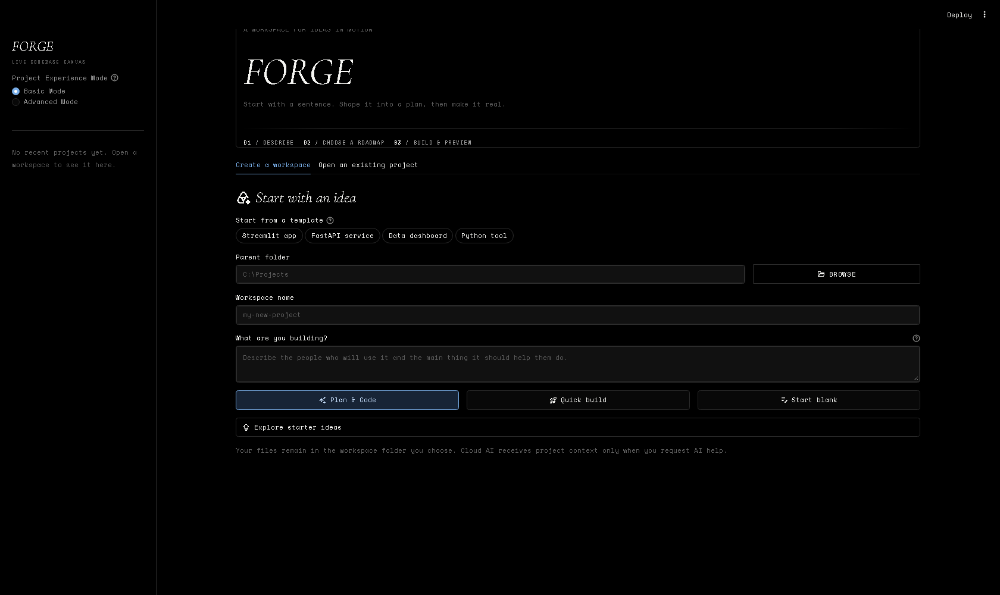
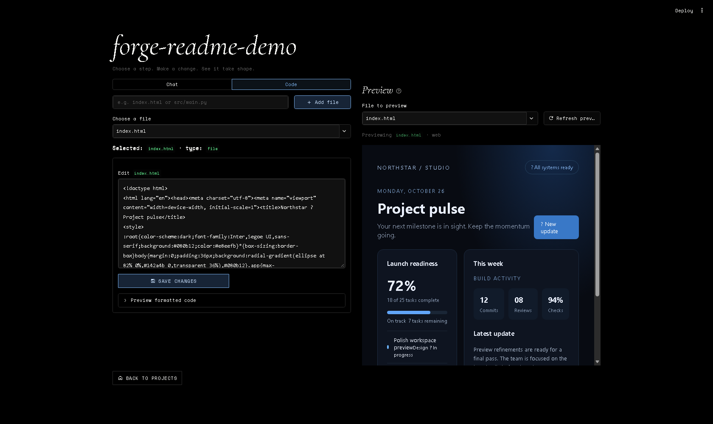

# FORGE — Live Codebase Canvas

FORGE turns a software idea into a reviewable project plan, a local workspace, and a place to build and preview it. It is a local-first Streamlit app: your files stay in the folders you choose, and AI is optional.

Built for the **Nebius x NVIDIA Global Hackathon**, FORGE uses the Nebius Token Factory OpenAI-compatible API with NVIDIA Nemotron models to turn an idea into a reviewable architecture and actionable roadmap.

## What you can do

- **Start your way:** create a workspace from an idea, choose a starter brief, start blank, or open an existing project.
- **Plan before generating files:** review an AI-proposed architecture and roadmap before scaffolding the proposed project structure.
- **Build incrementally:** follow roadmap steps, ask the optional AI assistant for help, generate starter code, and edit files directly.
- **Preview locally:** render HTML and its local assets in the preview pane, run Python scripts and see their output, or launch a Streamlit app inline.
- **Keep track of progress:** roadmap state is saved with each project under `.forge/roadmap.json`.
- **Work without a cloud AI account:** browse, edit, and preview local projects without configuring a cloud provider. Ollama can provide local AI when installed and running.

## Screenshots

Start from an idea or open an existing project:



Edit project files and see the live preview side by side:



## Demo walkthrough

1. Launch FORGE and select a starter idea or describe a project of your own.
2. Choose **Plan & Code** to review a proposed architecture and roadmap, or **Quick Build** to generate a starter implementation.
3. Open the workspace, inspect the project files, and pick a roadmap step to work on.
4. Edit a file, use the local preview, and mark a roadmap step complete.
5. Reopen the workspace to show that roadmap progress is retained.

Generated plans and code are starting points: review them and run the project's own checks before relying on them.

## Run locally

Use Python 3.10 or later. From the project root, create and activate a virtual environment, then install the app dependencies:

```powershell
py -m venv .venv
.\.venv\Scripts\Activate.ps1
python -m pip install -r requirements.txt
streamlit run app.py
```

On macOS or Linux, activate the environment with `source .venv/bin/activate` instead. The app opens at `http://localhost:8501`.

## Nebius Token Factory setup

Create a local `.env` file from the example, then paste your Token Factory API key into `NEBIUS_API_KEY`:

```powershell
Copy-Item .env.example .env
```

The project is pinned to Nebius with `FORGE_AI_PROVIDER=nebius`; `NEBIUS_API_KEY` is the only cloud API key needed. FORGE uses NVIDIA Nemotron 3 Nano 30B, the lowest-priced NVIDIA text model in the current Token Factory catalog ($0.06 per million input tokens and $0.24 per million output tokens when checked). It is the only Nebius model offered in the app, avoiding accidental selection of a more expensive model. Pricing can change; confirm current rates in the [Token Factory model catalog](https://tokenfactory.nebius.com/model-catalog.md). Keep `.env` local, never commit it, and do not paste a real key into source code or chat.

FORGE also retains optional support for local Ollama; it needs no cloud key. To use it intentionally, install Ollama, pull a model such as `qwen3.5:4b`, and set `FORGE_AI_PROVIDER=ollama` in your local `.env`. Restore `nebius` to return to Token Factory.

## Privacy and execution notes

- Project files are read from and written to the workspace folder you select.
- FORGE sends the project brief and relevant project context to Nebius Token Factory when you request AI planning, coding, or chat. Review Nebius' data policies before sending sensitive or private code.
- If you switch to Ollama, requests go to the Ollama server configured on your machine.
- Python preview runs the selected script as a subprocess **with the same operating-system permissions as FORGE**. It is not sandboxed. Only run code you trust.
- HTML previews serve only static project assets from a loopback-only preview endpoint. Treat untrusted project HTML and JavaScript with the same caution as any other web content.

## Tests

Install pytest if it is not already available in your environment, then run the automated tests:

```powershell
python -m pip install pytest
python -m pytest -v
```

GitHub Actions runs the test suite and a Python syntax check on Python 3.11 and 3.13 for pushes and pull requests.

## Project layout

```text
.
├── app.py                 # Streamlit entry point
├── assets/
│   ├── brand/             # Brand assets
│   └── moodboard/         # Static design reference
├── core/                  # AI integration, session defaults, roadmap persistence
├── services/              # Workspace file handling and preview execution
├── ui/                    # Streamlit UI components and themes
├── utils/                 # Shared path and UI helpers
├── tests/                 # Automated tests
├── scripts/               # Manual developer tools
├── examples/              # Standalone examples
└── docs/
    ├── planning/          # Project plan and roadmap
    └── prompts/           # Hackathon and development reference material
```

## Before a public release

FORGE is a hackathon prototype, not a hosted multi-user development service. Before wider distribution, prioritize sandboxing or disabling generated-code execution for untrusted projects, and rehearse a clean setup and the complete demo on the target machine. The automated test and syntax checks run in GitHub Actions. See [`docs/planning/ROADMAP.md`](docs/planning/ROADMAP.md) for additional planned improvements.

## License

This project is distributed under the [MIT License](LICENSE).
